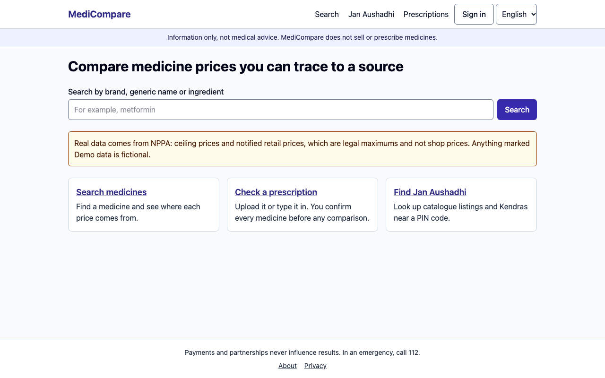
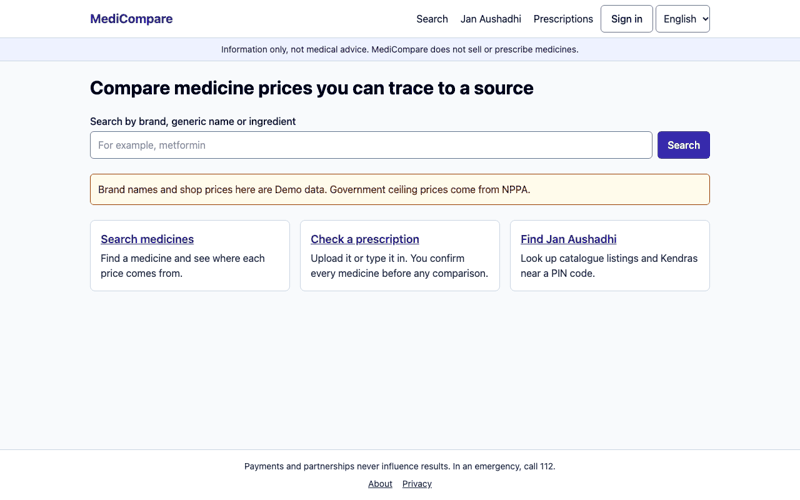
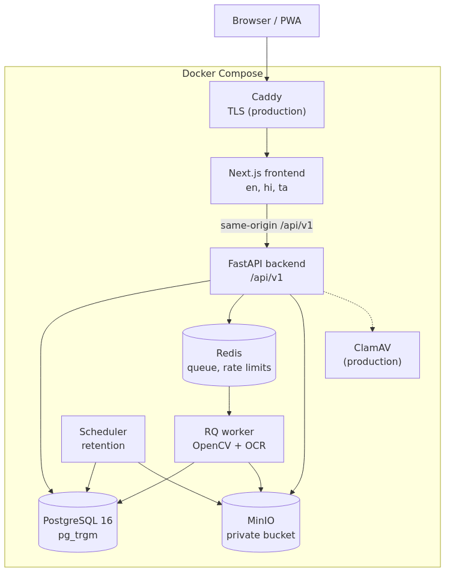

# MediCompare

A neutral, multilingual, mobile-first web app that helps people in India understand medicine prices and prepare a conversation with their doctor or pharmacist.

**Information only, not medical advice.** MediCompare does not sell, prescribe or dispense medicines. In an emergency, call 112.

**Read this first:**
- **Real data, from NPPA:** government ceiling prices, and notified retail prices naming real companies. Both are legal maximums, not shop prices.
- **Fictional demo data, labelled "Demo data" everywhere:** "Demo" brands and their shop prices, all Jan Aushadhi entries and all regulatory notices. See [data sources](docs/DATA_SOURCES.md). `make up-real` runs with real data only.
- OCR results are from **synthetic handwriting** and do not show real-world accuracy. See [evaluation](docs/EVALUATION.md).
- Not deployed. No user research has been done. No compliance is claimed.





## The problem
The same molecule at the same strength can cost many times more under one brand than another. Handwritten prescriptions are hard to read, brand and generic names are confusing, and it is hard to tell which prices to trust.

## What it does
- **Search** by brand, generic name or ingredient, with typo tolerance and Hindi and Tamil input. Exact and possible matches are separate, and each explains why it matched.
- **Compare prices** that always show type, source and date. Per-unit figures appear only for truly identical products.
- **Find options to discuss,** with every difference flagged. Unlike products are "not directly comparable", and a reason is given.
- **Jan Aushadhi lookup** by PIN, area or one-time location, with no stock claims.
- **Prescription check:** upload or type. OCR proposes, **a person confirms every medicine,** and the server refuses comparison until then.
- **Pharmacist review** of a prescription the user chooses to share with that pharmacist.
- **Shareable summary:** PDF and expiring link, confirmed medicines only.
- **Privacy controls:** metadata stripping, 7-day deletion, export, account deletion, guest use.
- **Admin import:** staging, validation, review queue, provenance, freshness, audit.
- **English, Hindi and Tamil.** Installable PWA with an offline page.

## Safety design
| Rule | Enforced by |
|---|---|
| Unverified items never reach comparison | `safety/gate.py`, a database constraint, API tests that bypass the UI |
| Similar names are never the same medicine | `matching/equivalence.py` takes attributes, never names |
| An unstated salt form proves nothing | Equivalence refuses, and shows why |
| Nothing is guessed | Fields are `visible`, `unclear` or `unknown` |
| Text in files is data | No instruction channel; injection tests on images and PDFs |
| Emergency input interrupts | Server-side detection in three languages, shows 112 |
| Ceiling price is never a shop price | Label on every price, and no "savings" across price types |

## Architecture


A modular monolith: Next.js, FastAPI, PostgreSQL with `pg_trgm`, Redis and RQ, private S3-compatible storage, OpenCV with Tesseract or RapidOCR. See [architecture](docs/ARCHITECTURE.md).

## Quick start
Needs Docker with Compose, about 8 GB of free disk, and ports 3000, 5433, 6380, 8000 and 9010 free.

```bash
make up
```

Open http://localhost:3000.

**Local demo accounts only** (`make up` creates them, and production refuses them). Password: `local-demo-only-password`.

| Role | Email |
|---|---|
| User | `demo.user@example.com` |
| Pharmacist | `demo.pharmacist@example.com` |
| Admin | `demo.admin@example.com` |

Try searching `metformn`, then `Telmisartan and Chlorthalidone` to compare real companies' NPPA prices, then `DemoAtorvAlpha` for a demo comparison. Type `I took too many tablets` to see the emergency interrupt. Add a prescription with `DemoMetacin`, strength `500 mg`, to see the look-alike check.

## Tests
```bash
make verify
```
This runs every gate and writes [VERIFICATION_REPORT.md](VERIFICATION_REPORT.md), with logs in `verification/logs/`. Run `make help` for individual gates. Frontend tools need `npm ci` in `frontend/`; `make verify` handles that.

## Limitations
- **No real shop prices.** Real data is NPPA's legal maximums, which cover five ceiling-price categories and recent new-drug approvals, not the whole market. Prices NPPA fixes also vary little between companies, so real savings look smaller than they might in shops. Actual MRPs are [the first open item](docs/OPEN_ITEMS.md).
- **OCR suggests little at safe thresholds,** and synthetic results flatter it.
- **The look-alike check is a string-similarity screen,** not a clinical list.
- **Hindi and Tamil were AI-written** and need native review, particularly the emergency and consent text.
- **Not tested** with real users, a real pharmacist, a screen-reader user or a low-end Android phone.
- **Not deployed.** CI runs on GitHub, on Linux, on every push to `main` and feature branches.

## Documentation
[Product](docs/PRODUCT.md) · [Architecture](docs/ARCHITECTURE.md) · [Database](docs/DATABASE.md) · [API](docs/API.md) · [OCR design](docs/AI_OCR_DESIGN.md) · [Evaluation](docs/EVALUATION.md) · [Security and privacy](docs/SECURITY_PRIVACY.md) · [Threat model](docs/THREAT_MODEL.md) · [Compliance notes](docs/COMPLIANCE_NOTES.md) · [Data sources](docs/DATA_SOURCES.md) · [Test plan](docs/TEST_PLAN.md) · [Deployment](docs/DEPLOYMENT.md) · [Operations](docs/OPERATIONS.md) · [UX](docs/UX.md) · [Decisions](docs/DECISIONS.md) · [Open items](docs/OPEN_ITEMS.md)

## Licence
Code is under the [MIT licence](LICENSE). NPPA data and fonts keep their own terms, as noted there. Ceiling prices are reproduced from the National Pharmaceutical Pricing Authority, Government of India. NPPA states that its lists do not replace the Gazette notifications, which remain the official version.
