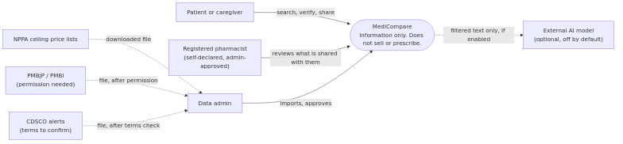
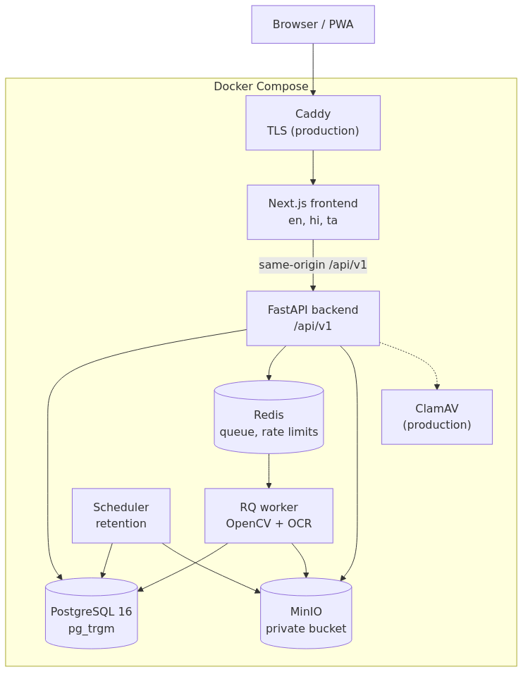
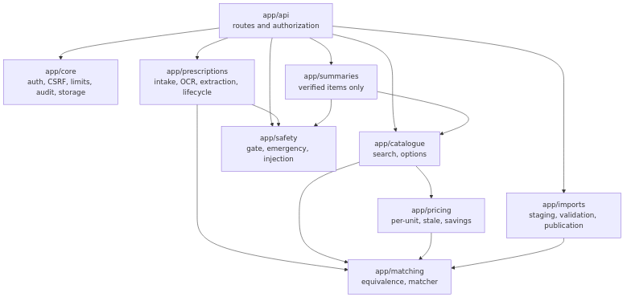
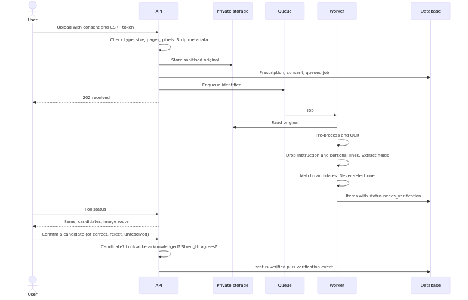
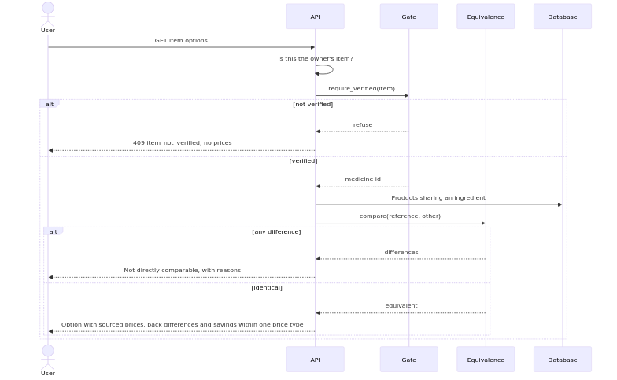
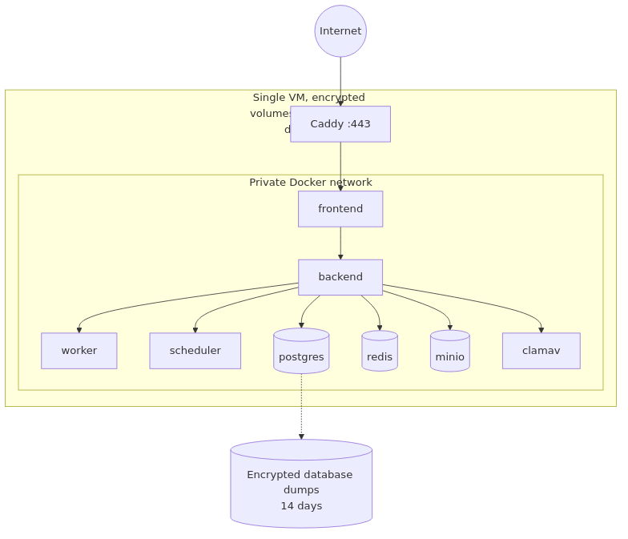

# Architecture

A modular monolith: one FastAPI application with clear internal modules, one worker for slow jobs, and one Next.js frontend.

## C4: context

## C4: containers

## C4: backend components

| Module | Responsibility |
|---|---|
| `app/safety` | Emergency detection, the verification gate, instruction detection |
| `app/matching` | `equivalence.py` decides "same medicine"; `matcher.py` ranks candidates |
| `app/pricing` | Per-unit prices, staleness and savings statements. Pure functions |
| `app/catalogue` | Search, medicine presentation, lower-cost options |
| `app/prescriptions` | Upload sanitising, pre-processing, OCR engines, extraction, confidence, lifecycle |
| `app/summaries` | Summary data and PDF, from verified items only |
| `app/imports` | Staging, validation, publication, seed, look-alike screen |
| `app/api` | HTTP routes and authorization |
| `app/core` | Problem details, auth, CSRF, rate limits, audit, storage |

**Dependency rule:** `safety`, `matching` and `pricing` import nothing from the database, web framework or each other's callers (except `pricing` using `matching.equivalence`). That keeps them strictly typed and property-testable.

## Sequence: prescription processing

## Sequence: comparison through the gate

## Deployment

## Architecture decision records
Full log in [DECISIONS.md](DECISIONS.md). The decisions that shape the system most:
- **Equivalence is one pure function** over attributes, never names ([D5](DECISIONS.md)).
- **The gate takes no confidence input:** a score can change a label, never access.
- **Images go through the API,** not signed URLs ([D8](DECISIONS.md)).
- **Guests are ordinary users with an expiry** ([D7](DECISIONS.md)).
- **Modular monolith:** one team, one database, and one transaction per request. The boundary that matters, OCR being slow and risky, is already a separate worker.

## Naming
Database, API and code use the same terms: `medicine`, `price_observation`, `extracted_item`, `candidate_match`, `verification_event`, `share_link`, `is_demo`, `needs_verification`.
