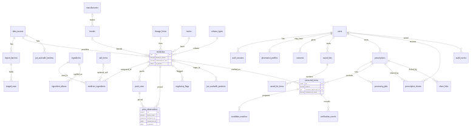

# Database

PostgreSQL 16 with `pg_trgm`. Schema source: [`backend/app/models.py`](../backend/app/models.py). Migrations: `backend/migrations`. Apply with `alembic upgrade head`. Reproducible seed: `python -m app.cli seed`.

Source: [diagrams/er.mmd](diagrams/er.mmd).

## Catalogue
| Table | Purpose | Key points |
|---|---|---|
| `data_sources` | Owner, URL, licence note, cadence, `is_demo` | Staleness uses `update_cadence_days` |
| `import_batches` | One file through staging | `status`: staged, validated, published, rejected. Stores SHA-256 |
| `staged_rows` | Raw and normalised row, errors | The review queue is `status='failed'` |
| `medicines` | A product, branded or generic | `equivalence_key`, `ingredient_key`, `search_text`, provenance columns, `is_demo` |
| `ingredients`, `salt_forms`, `dosage_forms`, `routes`, `release_types` | Vocabulary | Unique names |
| `ingredient_aliases` | Search-only spellings | Never used for equivalence |
| `medicine_ingredients` | Composition | Salt may be NULL, meaning unstated. `strength_value > 0` |
| `brands`, `manufacturers` | Brand data | Demo only in this build |
| `pack_sizes` | Quantity and unit | Quantity must be positive |
| `price_observations` | Append-only prices | `price_type` constrained, `amount_inr > 0`, `observed_at`, `valid_from`, `valid_to`, `is_demo`, batch and row provenance |
| `regulatory_flags` | Notices with source and date | Constrained `flag_type` |
| `lasa_pairs` | Look-alike names | `origin` says computed or clinical |
| `jan_aushadhi_products`, `jan_aushadhi_kendras` | PMBJP data | No stock column exists. PIN checked by constraint |

## Users and privacy
| Table | Purpose | Deletion |
|---|---|---|
| `users` | Role, hash, lockout, guest expiry | Hard delete cascades |
| `auth_sessions` | Keyed token hash, CSRF token | Removed when expired |
| `pharmacist_profiles` | Self-declared number, status | With the user |
| `consents` | Purpose, notice version, engine | With the user |
| `saved_lists`, `saved_list_items` | Saved medicines | With the user |

## Prescriptions
| Table | Purpose | Key constraint |
|---|---|---|
| `prescriptions` | Status, object keys, retention | Deleted with its objects |
| `processing_jobs` | Engine, version, duration, error code | Cascade |
| `extracted_items` | Field text plus `*_state`, scores, status | **`ck_verified_requires_identity`:** `verified` requires a medicine and a verifier type |
| `candidate_matches` | Rank, score, reasons, look-alike flag | Cascade |
| `verification_events` | Verifier type and user, action, diff, note | `verifier_type` is user or pharmacist |
| `prescription_shares` | Active share to one pharmacist | Revocable |
| `share_links` | Keyed token hash, expiry, revoked time | Removed 30 days after expiry |
| `audit_events` | Action and identifiers | No prescription text. Actor set NULL on deletion |

## Indexes
- Trigram GIN on `medicines.search_text`, `ingredients.name`, `jan_aushadhi_products.generic_name`.
- Full-text GIN on `to_tsvector('simple', medicines.search_text)`.
- B-tree on `equivalence_key`, `ingredient_key`, `is_demo`, foreign keys, `retention_until`, Kendra `pin_code` and `district`.
