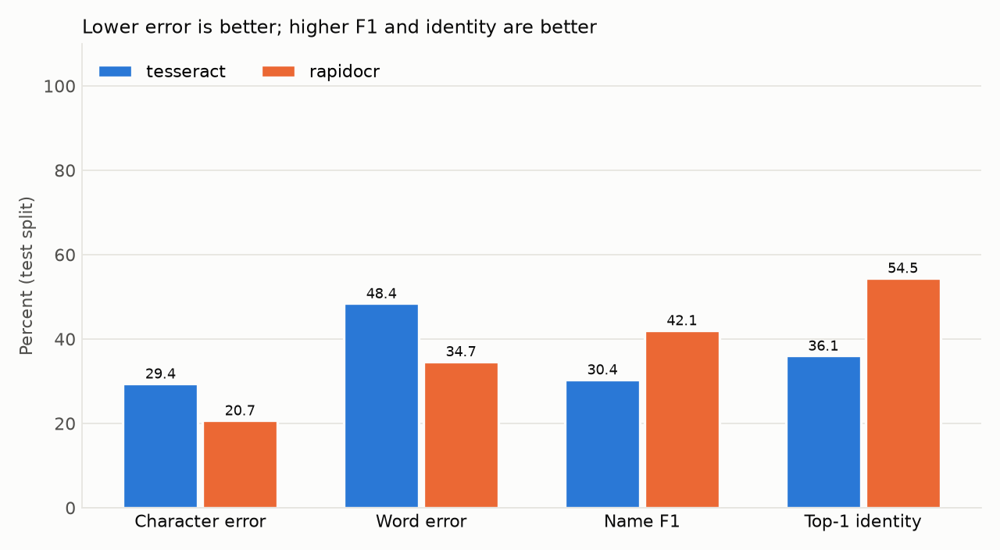
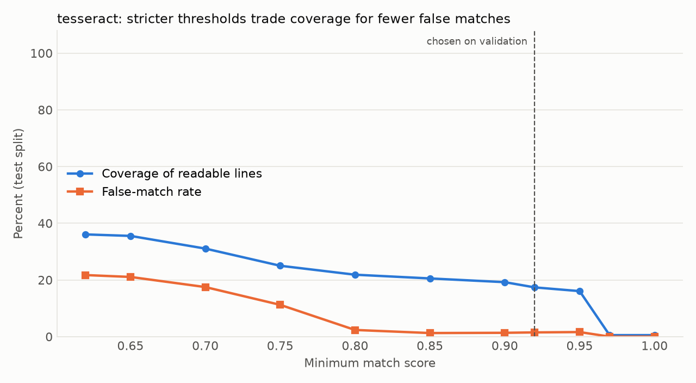
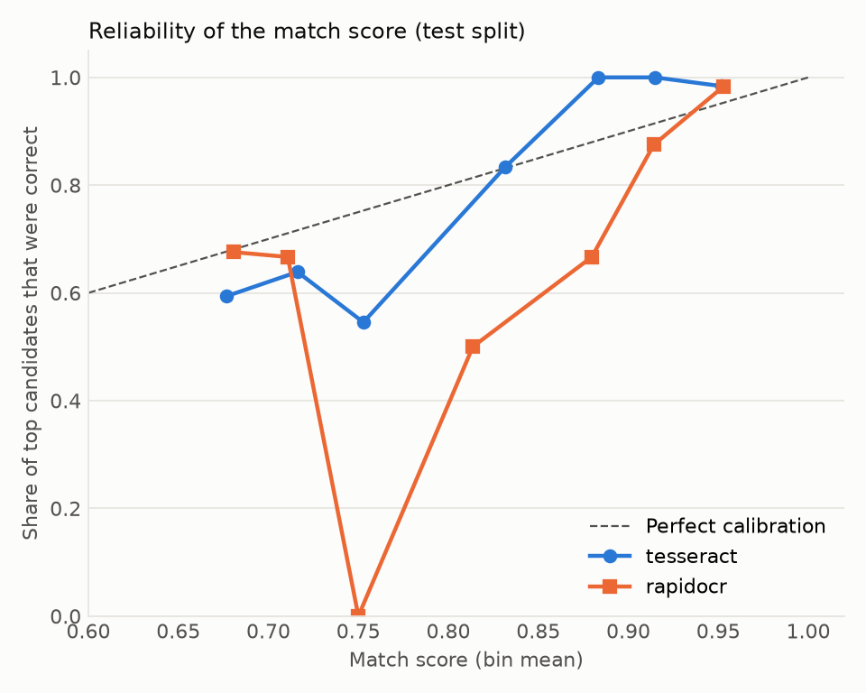

# OCR and matching evaluation

**Key limitation: these results come from synthetic handwriting fonts rendered on clean templates. Real doctor handwriting is much harder, so these numbers do not show real-world accuracy, and they must not be quoted without this caveat.**

Generated by `scripts/make_evaluation_doc.py` from [`results.json`](../evaluation/results/results.json). Reproduce with `make evaluate`.

## Headline
- **Catalogue used:** results were measured before NPPA retail prices were added, on the ceiling and demo catalogue. Matching rules did not change, but a larger catalogue could change false matches, so rerun `make evaluate` before relying on these figures.
- **Selected engine: tesseract**, using the rule fixed before scoring: lowest false-match rate on validation, then highest coverage.
- **On the test split at the calibrated thresholds:** 67 suggestions, 1 false match(es), a false-match rate of 1.5% (95% upper bound 8.0%), covering 17.4% of readable lines.
- **Read this as a low-coverage system:** at safe thresholds most lines get no suggestion, and the user must type or choose them. Every item needs human confirmation in any case.
- **rapidocr reads text better** (lower error, higher F1) but is about 2.5 times slower per page. **The difference in false-match rate between the engines is within noise:** their 95% ranges overlap heavily. Choosing an engine on this data alone is weak evidence.

## Dataset
- **Generator:** [`evaluation/generate.py`](../evaluation/generate.py), seed 20261105. 600 images: 360 train, 120 validation, 120 test. Nothing here is a real prescription, and all names are fictional.
- **Content:** catalogue names and strengths, frequency abbreviations, durations, a fictional doctor and patient header, eight open-licence (SIL OFL) handwriting fonts.
- **Degradations:** rotation, perspective, shadow, blur, noise, low resolution.
- **Hard cases:** look-alike brands, missing strength, FDCs, modified-release lines, illegible scribbles, injected instruction text.
- **Use of splits:** no model was trained, so the train split only informed rule development. Thresholds and the engine choice used validation only. Test was used only for this report.
- **Engines:** tesseract 5.3.0, rapidocr 1.4.4. TrOCR was not evaluated ([D3](DECISIONS.md)).

## How scoring works
- **Correct generic line:** the top candidate has the same ingredients, strengths, form and release type.
- **Correct brand line:** the top candidate is that exact product.
- **False match:** a suggestion that is not correct. This includes **any** suggestion on a line with a missing strength, an illegible span, or text that is not a medicine line, since abstaining is the only safe behaviour there.
- **False-match rate:** false matches divided by suggestions (the primary safety metric).
- **Coverage:** correct suggestions divided by lines whose identity is determinable from the page.
- **Abstention:** the share of truth lines that get no suggestion.
- **Name F1:** an extracted name counts if it is at least 90% similar to the truth.
- **Upper bound:** Wilson 95%.

## Results before calibration (test split)
| Metric | tesseract | rapidocr |
|---|---|---|
| Images | 120 | 120 |
| Medicine lines in truth | 397 | 397 |
| Character error rate (CER) | 29.4% | 20.7% |
| Word error rate (WER) | 48.4% | 34.7% |
| Medicine name precision | 34.9% | 47.0% |
| Medicine name recall | 27.0% | 38.0% |
| Medicine name F1 | 30.4% | 42.1% |
| Top candidate correct (exact-match accuracy) | 36.1% | 54.5% |
| Latency per page, p50 | 1.04 s | 2.63 s |
| Latency per page, p95 | 1.66 s | 4.03 s |

Every top candidate treated as a suggestion, with no thresholds:

| Engine | Suggestions | False matches | False-match rate |
|---|---|---|---|
| tesseract | 175 | 38 | 21.7% |
| rapidocr | 259 | 52 | 20.1% |

This shows why thresholds matter, and why the product never auto-selects: **about one in five unfiltered top candidates is wrong.**

## Calibration
Grid search over 99 pairs of OCR and match thresholds on the validation split. Rule: minimise the false-match rate among settings with at least 20 suggestions, then maximise correct suggestions.

| Engine | Split | Min OCR | Min match | Suggestions | False matches | False-match rate | 95% upper bound | Coverage | Abstention |
|---|---|---|---|---|---|---|---|---|---|
| tesseract | validation | 0.4 | 0.92 | 78 | 2 | 2.6% | 8.9% | 19.9% | 80.5% |
| tesseract | test | 0.4 | 0.92 | 67 | 1 | 1.5% | 8.0% | 17.4% | 83.1% |
| rapidocr | validation | 0.95 | 0.92 | 100 | 3 | 3.0% | 8.5% | 25.5% | 74.9% |
| rapidocr | test | 0.95 | 0.92 | 91 | 2 | 2.2% | 7.7% | 23.4% | 77.1% |

The dashed line is the threshold chosen on validation. Raising it past about 0.8 removes most false matches, while coverage falls more slowly. Above about 0.95, coverage collapses.

### Reliability

The score is **not a probability**. It is a ranking signal that happens to separate well near the top. Some bins have few items, so the curve is noisy. A score should never be shown to users as "% sure", and the UI labels it as match quality only.

## Hard cases (test split, calibrated thresholds)
| Hard case | Engine | Items read | Suggested | Correct | False matches |
|---|---|---|---|---|---|
| Ordinary line | tesseract | 211 | 60 | 60 | 0 |
| Ordinary line | rapidocr | 241 | 81 | 81 | 0 |
| Fixed-dose combination | tesseract | 14 | 2 | 2 | 0 |
| Fixed-dose combination | rapidocr | 22 | 3 | 2 | 1 |
| Modified release | tesseract | 26 | 4 | 3 | 1 |
| Modified release | rapidocr | 39 | 6 | 5 | 1 |
| Look-alike brand | tesseract | 9 | 1 | 1 | 0 |
| Look-alike brand | rapidocr | 8 | 1 | 1 | 0 |
| Missing strength | tesseract | 10 | 0 | 0 | 0 |
| Missing strength | rapidocr | 14 | 0 | 0 | 0 |
| Not a medicine line (illegible, injection, noise) | tesseract | 46 | 0 | 0 | 0 |
| Not a medicine line (illegible, injection, noise) | rapidocr | 12 | 0 | 0 | 0 |

**Injected instruction text:** 6 of 11 (tesseract) and 5 of 11 (rapidocr) injected lines were recognised and dropped. The others were garbled by OCR, so the detector did not recognise them. They were then ignored as not medicine-shaped or stayed below the thresholds. **Safety here rests on the pipeline having no instruction channel, and on human confirmation, rather than on the detector.**

## Degradations (test split, calibrated thresholds)
| Degradation | Images | tesseract CER | rapidocr CER | tesseract false matches | rapidocr false matches |
|---|---|---|---|---|---|
| rotation | 80 | 31.8% | 21.5% | 0 | 0 |
| perspective | 57 | 22.1% | 8.5% | 1 | 1 |
| shadow | 49 | 49.1% | 41.1% | 0 | 0 |
| blur | 55 | 33.1% | 24.9% | 0 | 0 |
| noise | 36 | 27.7% | 16.9% | 0 | 1 |
| low resolution | 41 | 33.0% | 25.4% | 0 | 0 |

## What this does and does not show
**It shows:** the pipeline can be measured reproducibly, thresholds cut false suggestions sharply on this data, and hard cases mostly produce abstention.

**It does not show:** accuracy on real handwriting, real phone photos, regional writing habits, abbreviations a doctor invents, or multi-language prescriptions. It says nothing about whether people confirm correctly when shown a suggestion. Fonts are far more regular than handwriting, the templates are clean, and catalogue names are the only names that appear.

**Sample size:** with about 67 suggestions, the 95% upper bound on false matches is 8.0%. Rare but serious errors cannot be ruled out at this scale.

## Future work: consented real-data protocol
Not started. No real prescription is in this repository.
1. **Ethics:** get institutional ethics committee approval and a data-protection review first.
2. **Consent:** written, specific, withdrawable consent from patients and prescribers, through a partner clinic or pharmacy.
3. **Collection:** at least 500 prescriptions across regions, specialties and languages, photographed on low-end phones. Redact identifiers before anyone sees them outside the clinic.
4. **Ground truth:** two pharmacists label independently and a third adjudicates. Report agreement.
5. **Isolation:** store in an encrypted, access-logged environment, never in this repository, and delete on a fixed schedule.
6. **Pre-registration:** fix metrics and thresholds rules before unblinding a held-out test set.
7. **Human factors:** measure how often users catch a wrong suggestion, since this is the real safety control.
8. **Release rule:** do not enable "possible match" labels on real data unless the false-match upper bound meets a limit agreed with pharmacists.
