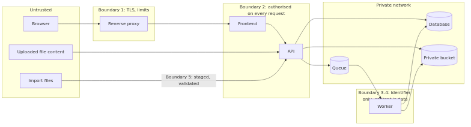

# Threat model (STRIDE)

## Trust boundaries

Source: [diagrams/trust_boundaries.mmd](diagrams/trust_boundaries.mmd).

1. **Internet to reverse proxy:** untrusted browsers, TLS terminates here.
2. **Frontend and API:** every request is authorised again by the API.
3. **API to worker:** a job carries only a prescription identifier.
4. **Uploaded file to pipeline:** file content is hostile data.
5. **Admin import to catalogue:** files are staged and validated, and never published directly.

## Threats and mitigations
| STRIDE | Threat | Mitigation | Evidence | Residual risk |
|---|---|---|---|---|
| **S**poofing | Password guessing | Argon2id, lockout with backoff, rate limit | `test_login_failure_is_generic_and_locks_with_backoff` | Distributed guessing below per-address limits |
| S | Fake pharmacist | Admin approval, number labelled self-declared | `test_pharmacist_registration_needs_admin_approval` | Depends on the admin's manual check |
| S | Stolen session cookie | `httpOnly`, `Secure`, `SameSite=Lax`, CSP, expiry | Cookie test, CSP unit test | Malware on the device |
| **T**ampering | Client marks an item verified | Server ignores extra fields; verify needs a candidate; DB constraint | `test_client_cannot_set_status_through_a_correction`, `test_database_constraint_...` | None known |
| T | Malicious text alters behaviour (prompt injection) | No instruction channel; lines dropped; LLM output anchored to input | `test_prompt_injection_*` | An injected line shaped like a real medicine line is still a candidate, and a person must confirm it |
| T | Bad data import | Staging, validation, review queue, provenance, audit | `test_admin_import_*` | An accurate-looking wrong price passes bounds checks |
| T | Cross-site request | CSRF token and Origin check | `test_csrf_*`, `test_cross_origin_*` | None known |
| **R**epudiation | Dispute over who verified | Verification events with type, user, time, diff | `test_no_item_can_reach_verified_without_an_event` | Audit rows are not tamper-evident |
| **I**nformation disclosure | Reading another user's prescription | Ownership checks return 404 | `test_another_user_cannot_...` | None known |
| I | Pharmacist overreach | Active named share required | `test_pharmacist_sees_only_what_is_shared_with_them` | A pharmacist may copy what they were shown |
| I | Share link leak | 256-bit token, hash stored, expiry, revoke, verified items only, no identifiers, `no-store`, `noindex` | `test_share_link_flow_and_expiry` | Anyone holding the link can read until expiry |
| I | GPS or personal details stored | Metadata stripped; identifying lines redacted from extracted text | `test_exif_*`, `test_personal_details_...` | **The image itself still shows the patient's name**, so it stays private and short-lived. Redaction misses unusual layouts |
| I | Health data in logs or errors | Audit holds identifiers only; validation errors omit input | `test_audit_log_never_...`, `test_validation_errors_...` | Reverse-proxy logs include URLs; a search query appears in a URL, so configure the proxy accordingly |
| **D**enial of service | Oversized files, decompression bombs | Limits before decode, request cap at the proxy | `test_oversized_*`, `test_tiny_and_huge_*` | OCR is CPU-heavy, and upload limits are per address |
| D | Queue flood | Upload rate limit fails closed | `test_rate_limit_*` | Many addresses could still back up the queue |
| **E**levation of privilege | User reaches admin or pharmacist routes | Role check on every route | `test_roles_are_enforced` | None known |
| E | Malicious PDF exploits parser | Render with pdfium as a non-root user; scan hook; PDF actions stripped | `test_pdf_metadata_...` | A pdfium or Pillow zero-day. The worker should be isolated from the API in production, and Compose separates the containers |

## Safety-specific threat
**Misidentified medicine through automation bias:** a user clicks "confirm" without looking. Mitigations are candidates with reasons, the image beside the fields, a forced acknowledgement for look-alikes, a block on conflicting strength, and no auto-selection. A hurried user can still confirm wrongly, so the summary always says to discuss with a doctor or pharmacist. **This risk is reduced, not removed.** It has not been measured with real users.
